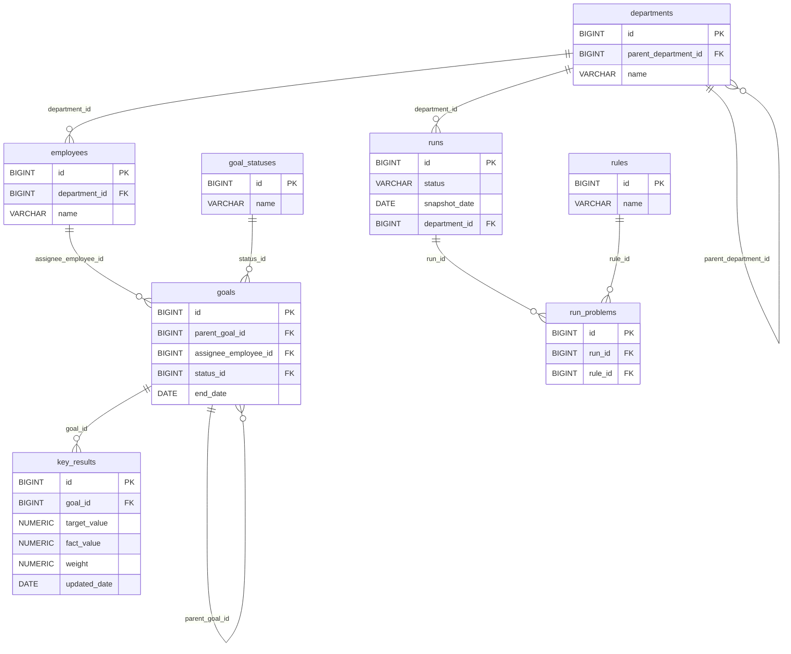

# Design

## Стек

- Java 21
- Spring Boot 3.5.6
- Spring Web
- Spring Data JPA
- PostgreSQL 18
- Flyway
- Maven
- JUnit 5

## Архитектура

- `api` — контроллеры, DTO, обработчики ошибок
- `application` — сервисы, бизнес-сценарии
- `domain` — сущности, бизнес-правила
- `infrastructure` — репозитории, конфигурация

## Модель данных

### Диаграмма



### Таблицы

#### departments — подразделения

| Поле | Тип данных | Ключ | Описание |
|---|---|---|---|
| id | BIGINT | PK | Идентификатор подразделения |
| parent_department_id | BIGINT | FK → departments.id | Родительское подразделение (NULL для корневого) |
| name | VARCHAR | | Название подразделения |

#### employees — сотрудники

| Поле | Тип данных | Ключ | Описание |
|---|---|---|---|
| id | BIGINT | PK | Идентификатор сотрудника |
| department_id | BIGINT | FK → departments.id | Подразделение сотрудника |
| name | VARCHAR | | Имя сотрудника |

#### goal_statuses — статусы целей

| Поле | Тип данных | Ключ | Описание |
|---|---|---|---|
| id | BIGINT | PK | Идентификатор статуса |
| name | VARCHAR | | Название статуса |

#### goals — цели

| Поле | Тип данных | Ключ | Описание |
|---|---|---|---|
| id | BIGINT | PK | Идентификатор цели |
| parent_goal_id | BIGINT | FK → goals.id | Родительская цель (NULL для верхнеуровневой) |
| assignee_employee_id | BIGINT | FK → employees.id | Исполнитель цели |
| status_id | BIGINT | FK → goal_statuses.id | Текущий статус цели |
| end_date | DATE | | Плановая дата завершения цели |

#### key_results — ключевые результаты

| Поле | Тип данных | Ключ | Описание |
|---|---|---|---|
| id | BIGINT | PK | Идентификатор ключевого результата |
| goal_id | BIGINT | FK → goals.id | Цель, к которой относится KR |
| target_value | NUMERIC | | Целевое значение |
| fact_value | NUMERIC | | Фактическое значение |
| weight | NUMERIC | | Вес KR в рамках цели |
| updated_date | DATE | | Дата последнего обновления факта |

#### rules — справочник правил

| Поле | Тип данных | Ключ | Описание |
|---|---|---|---|
| id | BIGINT | PK | Идентификатор правила |
| name | VARCHAR | | Название правила проверки |

#### runs — прогоны

| Поле | Тип данных | Ключ | Описание |
|---|---|---|---|
| id | BIGINT | PK | Идентификатор прогона |
| status | VARCHAR | | Статус прогона |
| snapshot_date | DATE | | Дата, на которую делается срез данных |
| department_id | BIGINT | FK → departments.id | Подразделение, по которому выполнен прогон |

#### run_problems — найденные проблемы

| Поле | Тип данных | Ключ | Описание |
|---|---|---|---|
| id | BIGINT | PK | Идентификатор проблемы |
| run_id | BIGINT | FK → runs.id | Прогон, в котором найдена проблема |
| rule_id | BIGINT | FK → rules.id | Правило, которое сработало |

## API

### Получение списка прогонов

GET /api/runs

#### Входные данные

Нет

#### Выходные данные

Массив объектов прогонов. Каждый элемент массива:

| Поле | Тип данных | Обязательность | Описание |
|---|---|---|---|
| id | BIGINT | Да | Идентификатор прогона (`runs.id`) |
| status | STRING | Да | Статус прогона (`runs.status`) |
| snapshotDate | DATE (`YYYY-MM-DD`) | Да | Дата снимка данных (`runs.snapshot_date`) |
| comparedRunId | BIGINT | Нет | Идентификатор прогона, с которым сравнивается текущий (`runs.compared_run_id`); `null`, если сравнения нет |
| problemsCount | INTEGER | Да | Число найденных проблем: `COUNT(run_problems)` по `run_id`; `0`, если проблем нет |

Пример ответа:

```json
[
  {
    "id": 2,
    "status": "COMPLETED",
    "snapshotDate": "2026-11-01",
    "comparedRunId": 1,
    "problemsCount": 5
  },
  {
    "id": 1,
    "status": "COMPLETED",
    "snapshotDate": "2026-10-01",
    "comparedRunId": null,
    "problemsCount": 3
  }
]
```

## Ключевые решения

Почему выбраны именно такие решения.

## Обработка ошибок

Формат ошибок, коды ошибок.