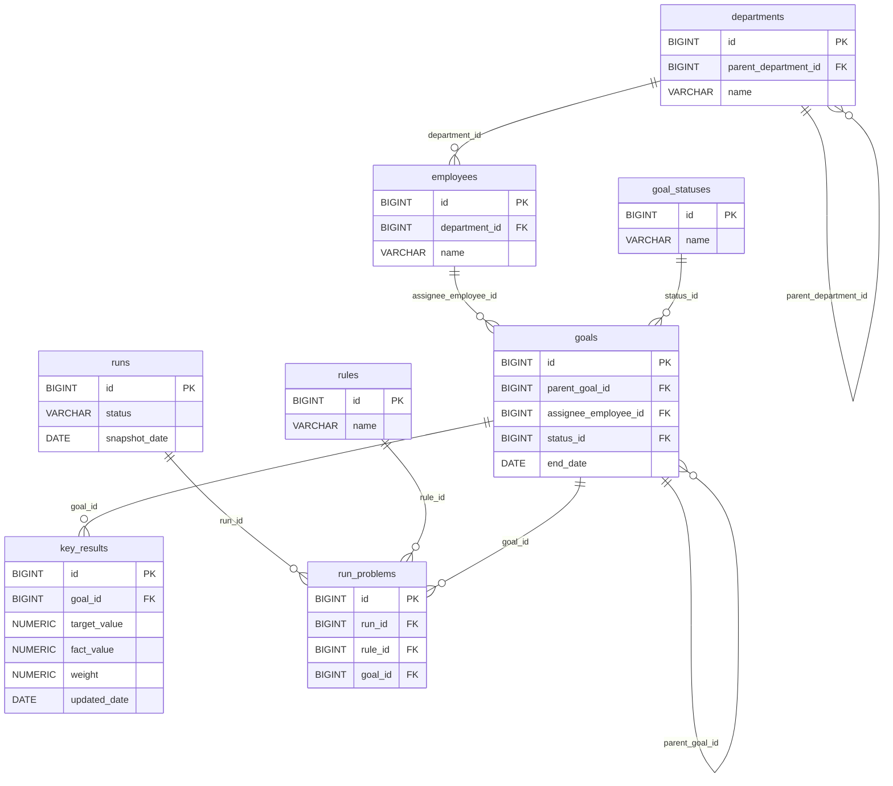

# Design

## Стек

- Java 21
- Spring Boot 3.5.6
- Spring Web
- Spring Data JPA
- PostgreSQL 18
- Flyway
- Maven
- JUnit 5

## Архитектура

- `api` — контроллеры, DTO, обработчики ошибок
- `application` — сервисы, бизнес-сценарии
- `domain` — сущности, бизнес-правила
- `infrastructure` — репозитории, конфигурация

## Модель данных

### Диаграмма



### Таблицы

#### departments — подразделения

| Поле | Тип данных | Ключ | Описание |
|---|---|---|---|
| id | BIGINT | PK | Идентификатор подразделения |
| parent_department_id | BIGINT | FK → departments.id | Родительское подразделение (NULL для корневого) |
| name | VARCHAR | | Название подразделения |

#### employees — сотрудники

| Поле | Тип данных | Ключ | Описание |
|---|---|---|---|
| id | BIGINT | PK | Идентификатор сотрудника |
| department_id | BIGINT | FK → departments.id | Подразделение сотрудника |
| name | VARCHAR | | Имя сотрудника |

#### goal_statuses — статусы целей

| Поле | Тип данных | Ключ | Описание |
|---|---|---|---|
| id | BIGINT | PK | Идентификатор статуса |
| name | VARCHAR | | Название статуса |

#### goals — цели

| Поле | Тип данных | Ключ | Описание |
|---|---|---|---|
| id | BIGINT | PK | Идентификатор цели |
| parent_goal_id | BIGINT | FK → goals.id | Родительская цель (NULL для верхнеуровневой) |
| assignee_employee_id | BIGINT | FK → employees.id | Исполнитель цели |
| status_id | BIGINT | FK → goal_statuses.id | Текущий статус цели |
| end_date | DATE | | Плановая дата завершения цели |

#### key_results — ключевые результаты

| Поле | Тип данных | Ключ | Описание |
|---|---|---|---|
| id | BIGINT | PK | Идентификатор ключевого результата |
| goal_id | BIGINT | FK → goals.id | Цель, к которой относится KR |
| target_value | NUMERIC | | Целевое значение |
| fact_value | NUMERIC | | Фактическое значение |
| weight | NUMERIC | | Вес KR в рамках цели |
| updated_date | DATE | | Дата последнего обновления факта |

#### rules — справочник правил

| Поле | Тип данных | Ключ | Описание |
|---|---|---|---|
| id | BIGINT | PK | Идентификатор правила |
| name | VARCHAR | | Название правила проверки |

#### runs — прогоны

| Поле | Тип данных | Ключ | Описание |
|---|---|---|---|
| id | BIGINT | PK | Идентификатор прогона |
| status | VARCHAR | | Статус прогона |
| snapshot_date | DATE | | Дата, на которую делается срез данных |

#### run_problems — найденные проблемы

| Поле | Тип данных | Ключ | Описание |
|---|---|---|---|
| id | BIGINT | PK | Идентификатор проблемы |
| run_id | BIGINT | FK → runs.id | Прогон, в котором найдена проблема |
| rule_id | BIGINT | FK → rules.id | Правило, которое сработало |
| goal_id | BIGINT | FK → goals.id | Цель, по которой найдена проблема |

## API

### Получение списка прогонов

GET /api/runs

#### Входные данные

Нет

#### Выходные данные

HTTP-код: `200 OK`.

Массив объектов прогонов. Каждый элемент массива:

| Поле | Тип данных | Обязательность | Описание |
|---|---|---|---|
| id | BIGINT | Да | Идентификатор прогона |
| status | STRING | Да | Статус прогона |
| snapshotDate | DATE (`YYYY-MM-DD`) | Да | Дата снимка данных |
| comparedRunId | BIGINT | Нет | Идентификатор прогона, с которым сравнивается текущий |
| problemsCount | INTEGER | Да | Число найденных проблем |

Пример ответа:

```json
[
  {
    "id": 2,
    "status": "COMPLETED",
    "snapshotDate": "2026-11-01",
    "comparedRunId": 1,
    "problemsCount": 5
  },
  {
    "id": 1,
    "status": "COMPLETED",
    "snapshotDate": "2026-10-01",
    "comparedRunId": null,
    "problemsCount": 3
  }
]
```

#### Алгоритм

1. Получить все прогоны из таблицы `runs`.
2. Для каждого прогона получить количество проблем из таблицы `run_problems` по `runs.id` = `run_problems.run_id`.
3. Отсортировать прогоны по дате снимка (snapshot_date) по убыванию (сначала самый новый); при равной дате - по `id` по убыванию.
4. Каждый прогон связать с предыдущим (прогон с ближайшей более ранней датой снимка).
    1. Если для прогона не найден предыдущий прогон, то предыдущий прогон установить null.
5. Вернуть список прогонов:

| Поле в ответе | Источник данных |
|---|---|
| id | runs.id |
| status  | runs.status |
| snapshotDate | runs.snapshot_date |
| comparedRunId | Предыдущий по `snapshot_date` прогон; `null`, если предыдущего нет |
| problemsCount | `COUNT(run_problems)` по `run_id`; `0`, если проблем нет |


#### Тестирование

##### Успешные сценарии

| № | Сценарий | Исходные данные | Ожидаемый результат |
|---|---|---|---|
| 1 | Пример из спецификации | Прогон 1 (`2026-10-01`, 3 проблемы), прогон 2 (`2026-11-01`, 5 проблем) | HTTP 200; порядок в массиве: сначала прогон 2, затем прогон 1; прогон 2: `comparedRunId=1`, `problemsCount=5`; прогон 1: `comparedRunId=null`, `problemsCount=3` |
| 2 | Цепочка из трёх прогонов | Прогоны с датами D1 < D2 < D3 | `comparedRunId`: D1 → `null`, D2 → id(D1), D3 → id(D2) |
| 3 | Подсчёт проблем | Прогон с 4 записями в `run_problems` | `problemsCount=4` |
| 4 | Прогон без проблем | Прогон без записей в `run_problems` | `problemsCount=0` (не `null`) |
| 5 | Проблемы не смешиваются между прогонами | Прогон A — 2 проблемы, прогон B — 7 проблем | A: `2`, B: `7` |
| 6 | Формат ответа | Любой непустой набор | `Content-Type: application/json`; поля `id`, `status`, `snapshotDate`, `comparedRunId`, `problemsCount`; `snapshotDate` в формате `YYYY-MM-DD`; `comparedRunId: null` присутствует в JSON явно |
| 7 | Разные статусы | Прогоны со статусами `COMPLETED` и другими | Возвращаются все прогоны, `status` передаётся без изменений |

##### Краевые сценарии

| № | Сценарий | Исходные данные | Ожидаемый результат |
|---|---|---|---|
| 8 | Нет прогонов | Таблица `runs` пуста | HTTP 200, `[]` (не 404, не `null`) |
| 9 | Один прогон | Одна запись в `runs` | Один элемент, `comparedRunId=null` |
| 10 | Порядок `id` не совпадает с порядком дат | Прогон `id=5` с датой `2026-01-01`, прогон `id=2` с датой `2026-06-01` | Предыдущий определяется по `snapshot_date`, а не по `id`: у `id=2` `comparedRunId=5`, у `id=5` — `null` |
| 11 | Одинаковая `snapshot_date` у нескольких прогонов | Два прогона с одной датой | Результат детерминирован при повторных вызовах; связывание не образует цикл и не ссылается на сам прогон (tie-break: при равной дате прогон с большим `id` считается более новым, т.е. сравнивается с прогоном с меньшим `id`) |
| 12 | Прогон не ссылается сам на себя | Любой набор | Ни у одного элемента `comparedRunId` не равен его `id` |
| 13 | Прогон прошлого или будущего в сравнении с текущей датой | `snapshot_date` в далёком прошлом / будущем | Обрабатываются как обычные, сортировка корректна |
| 15 | Большой объём | ~1000 прогонов, у каждого десятки проблем | HTTP 200, значения корректны; число SQL-запросов не растёт пропорционально числу прогонов (нет N+1) |
| 16 | Метод не поддерживается | `POST /api/runs` | HTTP 405 в едином формате ошибок |
| 17 | Ошибка БД | Репозиторий выбрасывает исключение | HTTP 500 в едином формате ошибок, без утечки деталей (стектрейс, SQL) |

### Проверка состояния сервиса

GET /actuator/health

Стандартный эндпоинт Spring Boot Actuator. Используется для проверки работоспособности сервиса (в том числе доступности PostgreSQL), например в healthcheck Docker.

#### Входные данные

Нет

#### Выходные данные

Объект состояния сервиса:

| Поле | Тип данных | Обязательность | Описание |
|---|---|---|---|
| status | STRING | Да | Общий статус: `UP` — сервис работоспособен, `DOWN` — нет (HTTP 503) |

Пример ответа (HTTP 200):

```json
{
  "status": "UP"
}
```

Пример ответа (HTTP 503):

```json
{
  "status": "DOWN"
}
```

Детали компонентов (`components`) не раскрываются: `management.endpoint.health.show-details=never` (по умолчанию).

#### Алгоритм

Не требуется

#### Тестирование

Не требуется

### Получение списка проблем прогона

GET /api/kkd/issues

#### Выходные данные

HTTP-код: `200 OK` .

Массив объектов проблем прогона. Каждый элемент массива:

| Поле | Тип данных | Обязательность | Описание |
|---|---|---|---|
| id | BIGINT | Да | Идентификатор проблемы |
| problemName | STRING | Да | Текст проблемы |
| status | STRING | Да | Статус |

Пример ответа:

```json
[
  {
    "id": 2,
    "problemName": "GOAL_NO_OWNER",
    "status": "critical"
  },
  {
    "id": 1,
    "status": "COMPLETED",
    "snapshotDate": "2026-10-01",
    "comparedRunId": null,
    "problemsCount": 3
  }
]
```

## Ключевые решения

### Тестирование

Уровни: сервис (unit, репозиторий замокан); контроллер (`@WebMvcTest` + `MockMvc`) — формат ответа и коды; интеграционный (PostgreSQL + Flyway) — реальный запрос и подсчёт `run_problems`.

HTTP-сервер в тестах не запускается: никаких `@SpringBootTest(webEnvironment = RANDOM_PORT/DEFINED_PORT)` и `TestRestTemplate`. Запросы выполняются через `MockMvc` (без сетевого порта); интеграционные тесты проверяют сервис и репозиторий напрямую (`@DataJpaTest` или `@SpringBootTest(webEnvironment = MOCK)`), без HTTP.

## Обработка ошибок

Все ошибки возвращаются в едином формате (`Content-Type: application/json`):

| Поле | Тип данных | Обязательность | Описание |
|---|---|---|---|
| code | STRING | Да | Машинный код ошибки |
| message | STRING | Да | Описание ошибки без внутренних деталей (стектрейс, SQL) |

Пример:

```json
{
  "code": "INTERNAL_ERROR",
  "message": "Внутренняя ошибка сервера"
}
```

Коды ошибок:

| HTTP-код | code | Когда возникает |
|---|---|---|
| 404 | `NOT_FOUND` | Ресурс не найден |
| 405 | `METHOD_NOT_ALLOWED` | HTTP-метод не поддерживается эндпоинтом (заголовок `Allow` сохраняется) |
| 500 | `INTERNAL_ERROR` | Любая непредвиденная ошибка, в том числе ошибка БД; детали пишутся только в лог |

Ошибки `/actuator/health` описаны в соответствующем разделе и этим форматом не покрываются.
