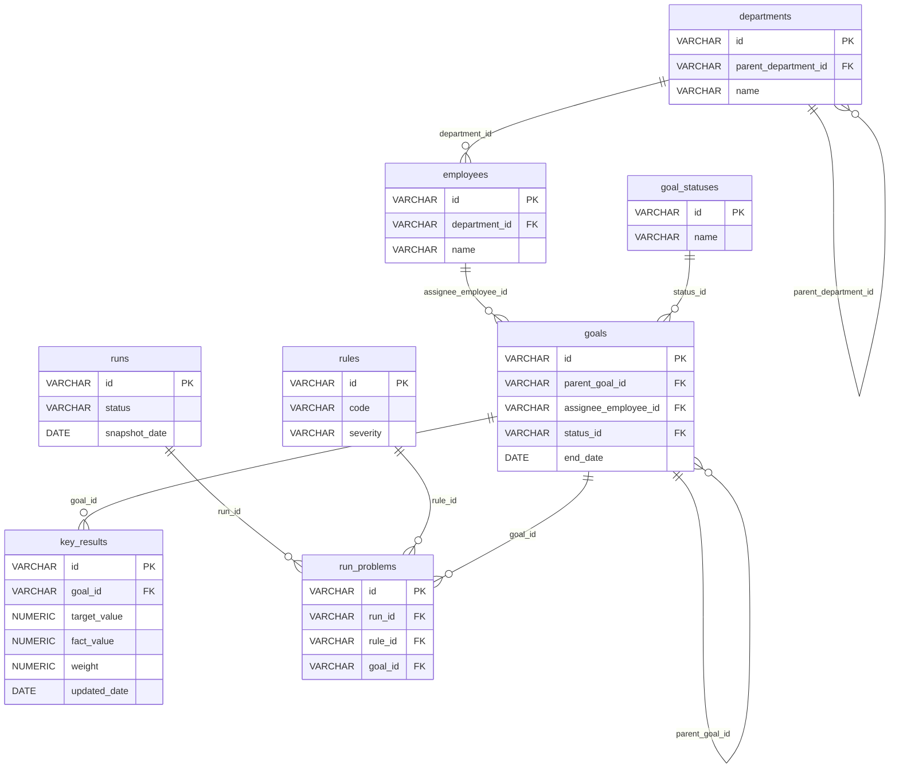

# Design

## Стек

- Java 21
- Spring Boot 3.5.6
- Spring Web
- Spring Data JPA
- PostgreSQL 18
- Liquibase
- Maven
- JUnit 5


## Архитектура

- `api` — контроллеры, DTO, обработчики ошибок
- `application` — сервисы, бизнес-сценарии
- `domain` — сущности, бизнес-правила
- `infrastructure` — репозитории, конфигурация


## Модель данных

### Диаграмма



### Таблицы

#### departments — подразделения

<details>
<summary>Поля</summary>

| Поле | Тип данных | Ключ | Описание |
|---|---|---|---|
| id | VARCHAR | PK | Идентификатор подразделения |
| parent_department_id | VARCHAR | FK → departments.id | Родительское подразделение (NULL для корневого) |
| name | VARCHAR | | Название подразделения |

</details>


#### employees — сотрудники

<details>
<summary>Поля</summary>

| Поле | Тип данных | Ключ | Описание |
|---|---|---|---|
| id | VARCHAR | PK | Идентификатор сотрудника |
| department_id | VARCHAR | FK → departments.id | Подразделение сотрудника |
| name | VARCHAR | | Имя сотрудника |

</details>


#### goal_statuses — статусы целей

<details>
<summary>Поля</summary>

| Поле | Тип данных | Ключ | Описание |
|---|---|---|---|
| id | VARCHAR | PK | Идентификатор статуса |
| name | VARCHAR | | Название статуса |

</details>


#### goals — цели

<details>
<summary>Поля</summary>

| Поле | Тип данных | Ключ | Описание |
|---|---|---|---|
| id | VARCHAR | PK | Идентификатор цели |
| parent_goal_id | VARCHAR | FK → goals.id | Родительская цель (NULL для верхнеуровневой) |
| assignee_employee_id | VARCHAR | FK → employees.id | Исполнитель цели |
| status_id | VARCHAR | FK → goal_statuses.id | Текущий статус цели |
| end_date | DATE | | Плановая дата завершения цели |

</details>


#### key_results — ключевые результаты

<details>
<summary>Поля</summary>

| Поле | Тип данных | Ключ | Описание |
|---|---|---|---|
| id | VARCHAR | PK | Идентификатор ключевого результата |
| goal_id | VARCHAR | FK → goals.id | Цель, к которой относится KR |
| target_value | NUMERIC | | Целевое значение |
| fact_value | NUMERIC | | Фактическое значение |
| weight | NUMERIC | | Вес KR в рамках цели |
| updated_date | DATE | | Дата последнего обновления факта |

</details>


#### rules — справочник правил

<details>
<summary>Поля</summary>

| Поле | Тип данных | Ключ | Описание |
|---|---|---|---|
| id | VARCHAR | PK | Идентификатор правила |
| code | VARCHAR | | Код правила проверки |
| severity | VARCHAR | | Важность |

</details>


#### runs — прогоны

<details>
<summary>Поля</summary>

| Поле | Тип данных | Ключ | Описание |
|---|---|---|---|
| id | VARCHAR | PK | Идентификатор прогона |
| status | VARCHAR | | Статус прогона |
| snapshot_date | DATE | | Дата, на которую делается срез данных |

</details>


#### run_problems — найденные проблемы

<details>
<summary>Поля</summary>

| Поле | Тип данных | Ключ | Описание |
|---|---|---|---|
| id | VARCHAR | PK | Идентификатор проблемы |
| run_id | VARCHAR | FK → runs.id | Прогон, в котором найдена проблема |
| rule_id | VARCHAR | FK → rules.id | Правило, которое сработало |
| goal_id | VARCHAR | FK → goals.id | Цель, по которой найдена проблема |

</details>


### Миграции и стартовые данные

Миграции — Liquibase, changelog в формате SQL: `src/main/resources/db/changelog/db.changelog-master.yaml` подключает файлы из `changes/` по порядку.

| Файл | Содержимое | context |
|---|---|---|
| `001-init-schema.sql` | Схема БД | — (выполняется всегда) |
| `002-seed-reference.sql` | Справочники: `goal_statuses`, `rules` (4 правила: `GOAL_NO_OWNER`, `GOAL_NO_KR`, `KR_WEIGHTS_SUM`, `KR_STALE_PROGRESS`) | `seed` |
| `003-seed-goals.sql` | 3 подразделения (иерархия `HQ-CIB` → `CIB-SALES`, отдельный `HQ-RETAIL`), 6 сотрудников, 25 целей, 30 КР | `seed` |
| `004-seed-runs.sql` | Прогоны `RUN-001` (2026-10-19) и `RUN-002` (2026-10-26) и по 10 проблем в каждом | `seed` |

Правила:

- Каждый changeSet содержит явный `--rollback`; откат выполняется в порядке, обратном накату (с учётом внешних ключей).
- Откат стартовых данных очищает таблицы целиком: стенд тестовый, пользовательских данных в них нет.
- Накат → откат → повторный накат проверяется автотестом `MigrationRollbackTest` (PostgreSQL в Testcontainers) и вручную через `liquibase-maven-plugin` (см. README).
- Интеграционные тесты репозиториев запускаются с `spring.liquibase.contexts=schema` (`src/test/resources/application.properties`): стартовые данные не накатываются, тесты создают свои.
- Стартовые данные согласованы: срез целей соответствует `RUN-002`; `RUN-002` относительно `RUN-001` — новых 3, сохранившихся 7, исправленных 3. Граничные случаи: КР, обновлённый ровно 45 дней назад (`G-14`), не нарушает `KR_STALE_PROGRESS`, на 46-й день (`G-13`) — нарушает; неактивные цели (`G-06`, `G-07`, `G-23`) правилами не проверяются.
- Изменение уже применённых changeSet'ов запрещено (контрольные суммы Liquibase): изменения схемы добавляются новым файлом и новым `include`.


## API

### Проверка состояния сервиса

GET /actuator/health

<details>
<summary>Описание эндпоинта</summary>

Стандартный эндпоинт Spring Boot Actuator. Используется для проверки работоспособности сервиса (в том числе доступности PostgreSQL), например в healthcheck Docker.

#### Входные данные

Нет

Пример запроса:

```
GET /actuator/health
```

#### Выходные данные

Возможные HTTP-коды:

| HTTP-код | Когда возвращается |
|---|---|
| `200 OK` | Сервис работоспособен (`status=UP`) |
| `503 Service Unavailable` | Сервис или БД недоступны (`status=DOWN`) |

Объект состояния сервиса:

| Поле | Тип данных | Обязательность | Описание |
|---|---|---|---|
| status | STRING | Да | Общий статус: `UP` — сервис работоспособен, `DOWN` — нет (HTTP 503) |

Пример ответа (HTTP 200):

```json
{
  "status": "UP"
}
```

Пример ответа (HTTP 503):

```json
{
  "status": "DOWN"
}
```

Детали компонентов (`components`) не раскрываются: `management.endpoint.health.show-details=never` (по умолчанию).

#### Алгоритм

Не требуется

#### Тестирование

Не требуется

</details>


### Получение списка прогонов

GET /api/runs

<details>
<summary>Описание эндпоинта</summary>

#### Входные данные

Нет

Пример запроса:

```
GET /api/runs
```

#### Выходные данные

Возможные HTTP-коды:

| HTTP-код | Когда возвращается |
|---|---|
| `200 OK` | Запрос выполнен успешно (если прогонов нет — пустой массив `[]`) |

Массив объектов прогонов. Каждый элемент массива:

| Поле | Тип данных | Обязательность | Описание |
|---|---|---|---|
| id | STRING | Да | Идентификатор прогона |
| status | STRING | Да | Статус прогона |
| snapshot_date | DATE (`YYYY-MM-DD`) | Да | Дата снимка данных |
| compared_run_id | STRING | Нет | Идентификатор прогона, с которым сравнивается текущий |
| problems_count | INTEGER | Да | Число найденных проблем |

Пример ответа:

```json
[
    {
        "id": "RUN-002",
        "status": "COMPLETED",
        "snapshot_date": "2026-10-26",
        "compared_run_id": "RUN-001",
        "problems_count": 10
    },
    {
        "id": "RUN-001",
        "status": "COMPLETED",
        "snapshot_date": "2026-10-19",
        "compared_run_id": null,
        "problems_count": 10
    }
]
```

#### Алгоритм

1. Получить все прогоны из таблицы `runs`.
2. Для каждого прогона получить количество проблем из таблицы `run_problems` по `runs.id` = `run_problems.run_id`.
3. Отсортировать прогоны по дате снимка (snapshot_date) по убыванию (сначала самый новый); при равной дате - по `id` по убыванию (строковое сравнение).
4. Каждый прогон связать с предыдущим (прогон с ближайшей более ранней датой снимка).
    1. Если для прогона не найден предыдущий прогон, то предыдущий прогон установить null.
5. Вернуть список прогонов:

| Поле в ответе | Источник данных |
|---|---|
| id | runs.id |
| status  | runs.status |
| snapshot_date | runs.snapshot_date |
| compared_run_id | Предыдущий по `snapshot_date` прогон; `null`, если предыдущего нет |
| problems_count | `COUNT(run_problems)` по `run_id`; `0`, если проблем нет |


#### Тестирование

##### Успешные сценарии

| № | Сценарий | Исходные данные | Ожидаемый результат |
|---|---|---|---|
| 1 | Пример из спецификации | Прогон `RUN-001` (`2026-10-01`, 3 проблемы), прогон `RUN-002` (`2026-11-01`, 5 проблем) | HTTP 200; порядок в массиве: сначала `RUN-002`, затем `RUN-001`; `RUN-002`: `compared_run_id=RUN-001`, `problems_count=5`; `RUN-001`: `compared_run_id=null`, `problems_count=3` |
| 2 | Цепочка из трёх прогонов | Прогоны с датами D1 < D2 < D3 | `compared_run_id`: D1 → `null`, D2 → id(D1), D3 → id(D2) |
| 3 | Подсчёт проблем | Прогон с 4 записями в `run_problems` | `problems_count=4` |
| 4 | Прогон без проблем | Прогон без записей в `run_problems` | `problems_count=0` (не `null`) |
| 5 | Проблемы не смешиваются между прогонами | Прогон A — 2 проблемы, прогон B — 7 проблем | A: `2`, B: `7` |

##### Краевые сценарии

| № | Сценарий | Исходные данные | Ожидаемый результат |
|---|---|---|---|
| 6 | Нет прогонов | Таблица `runs` пуста | HTTP 200, `[]` (не 404, не `null`) |
| 7 | Один прогон | Одна запись в `runs` | Один элемент, `compared_run_id=null` |

</details>


### Получение метрик по целям и ключевым результатам

GET /api/kkd/summary

<details>
<summary>Описание эндпоинта</summary>

#### Входные данные

| Поле | Тип данных | Обязательность | Описание |
|---|---|---|---|
| run_id | STRING | Да | Идентификатор прогона |
| unit_id | STRING | Да | Идентификатор подразделения |

Пример запроса:

```
GET /api/kkd/summary?run_id=RUN-008&unit_id=HQ-CIB
```

#### Выходные данные

Возможные HTTP-коды:

| HTTP-код | Когда возвращается |
|---|---|
| `200 OK` | Запрос выполнен успешно |
| `404 Not Found` | Прогон с `run_id` не найден или подразделение с `unit_id` не найдено (алгоритм, шаги 1.1 и 3.1) |
| `422 Unprocessable Entity` | Не указан `run_id` или `unit_id` |

Тело ошибки — в едином формате, см. «Обработка ошибок».

Объект со сводкой метрик. Поля верхнего уровня:

| Поле | Тип данных | Обязательность | Описание |
|---|---|---|---|
| run | OBJECT | Да | Текущий прогон |
| run.id | STRING | Да | Идентификатор прогона |
| run.snapshot_date | DATE (`YYYY-MM-DD`) | Да | Дата снимка данных |
| compared_to | OBJECT | Нет | Прогон, с которым сравнивается текущий; `null`, если предыдущего прогона нет |
| compared_to.id | STRING | Да | Идентификатор прогона сравнения |
| compared_to.snapshot_date | DATE (`YYYY-MM-DD`) | Да | Дата снимка данных прогона сравнения |
| unit | OBJECT | Да | Подразделение, по которому построена сводка |
| unit.id | STRING | Да | Идентификатор подразделения |
| unit.name | STRING | Да | Название подразделения |
| metrics | ARRAY | Да | Метрики качества данных по целям и ключевым результатам |
| issues_by_severity | ARRAY | Да | Количество проблем в разрезе критичности |
| delta | OBJECT | Да | Изменение набора проблем относительно прогона сравнения |

<details>
<summary>Элемент `metrics`</summary>

| Поле | Тип данных | Обязательность | Описание |
|---|---|---|---|
| key | STRING | Да | Машинный ключ метрики (например, `clean_goals_share`) |
| title | STRING | Да | Название метрики для отображения |
| unit | STRING | Да | Единица измерения значения (например, `%`) |
| value | NUMERIC | Да | Значение метрики в текущем прогоне |
| previous | NUMERIC | Нет | Значение метрики в прогоне сравнения; `null`, если прогона сравнения нет |
| delta | NUMERIC | Нет | Изменение: `value - previous`; `null`, если прогона сравнения нет |
| trend | STRING | Да | Направление изменения: `better` — улучшение, `worse` — ухудшение, `same` — без изменений |

</details>

<details>
<summary>Элемент `issues_by_severity`</summary>

| Поле | Тип данных | Обязательность | Описание |
|---|---|---|---|
| code | STRING | Да | Код критичности (например, `critical`, `major`) |
| current | INTEGER | Да | Количество проблем в текущем прогоне |
| previous | INTEGER | Нет | Количество проблем в прогоне сравнения; `null`, если прогона сравнения нет |
| delta | INTEGER | Нет | Изменение: `current - previous`; `null`, если прогона сравнения нет |

</details>

<details>
<summary>Объект `delta`</summary>

| Поле | Тип данных | Обязательность | Описание |
|---|---|---|---|
| new | INTEGER | Да | Количество новых проблем (есть в текущем прогоне, нет в прогоне сравнения) |
| persisting | INTEGER | Да | Количество сохранившихся проблем (есть в обоих прогонах) |
| resolved | INTEGER | Да | Количество устранённых проблем (были в прогоне сравнения, нет в текущем) |

</details>

Пример ответа:

```json
{
  "run": { "id": "RUN-008", "snapshot_date": "2026-10-26" },
  "compared_to": { "id": "RUN-007", "snapshot_date": "2026-10-19" },
  "unit": { "id": "HQ-CIB", "name": "Департамент корпоративного бизнеса" },
  "metrics": [
    {
      "key": "clean_goals_share",
      "title": "Доля корректных целей",
      "unit": "%",
      "value": 56.5,
      "previous": 62.7,
      "delta": -6.2,
      "trend": "worse"
    }
  ],
  "issues_by_severity": [
    { "code": "critical", "current": 2, "previous": 2, "delta": 0 },
    { "code": "major", "current": 23, "previous": 15, "delta": 8 }
  ],
  "delta": { "new": 10, "persisting": 33, "resolved": 2 }
}
```

#### Алгоритм

1. Получить прогон из таблицы `runs` по условию: runs.id = run_id.
    1. Если прогон не найден, то вернуть 404 с ошибкой "Прогон с ID {run_id} не найден".
2. Получить предыдущий прогон: отсортировать таблицу `runs` по snapshot_date по убыванию, отфильтровать по условию: snapshot_date < snapshot_date из полученного прогона на предыдущем шаге, и взять первую полученную запись.
3. Получить подразделение сотрудников из таблицы `departments` по условию: departments.id = unit_id.
    1. Если подразделение не найдено, то вернуть 404 с ошибкой "Подразделение с ID {unit_id} не найдено".
4. Определить набор подразделений для расчёта: подразделение из шага 3 и все его вложенные подразделения (рекурсивно по `departments.parent_department_id`).
5. Получить цели подразделения: записи `goals`, у которых `goals.assignee_employee_id` = `employees.id` и `employees.department_id` входит в набор подразделений из шага 4. Если целей нет, расчёт продолжается (см. п. 7.1).
6. Получить проблемы для расчёта: записи `run_problems` с присоединённым правилом (`run_problems.rule_id` = `rules.id`), у которых `run_problems.goal_id` входит в цели из шага 5. Выбрать отдельно:
    1. проблемы текущего прогона (`run_problems.run_id` = `run_id`);
    2. проблемы предыдущего прогона (`run_problems.run_id` = id прогона из шага 2) — только если предыдущий прогон найден.
7. Рассчитать метрики (все три, в указанном порядке) отдельно для текущего и предыдущего прогонов. Метрики считаются по целям и проблемам всего подразделения с учётом дочерних (шаги 4–6). Значения округляются до 1 знака (`HALF_UP`):

    | key | title | unit | Формула `value` | Что считается улучшением |
    |---|---|---|---|---|
    | `clean_goals_share` | Доля корректных целей | `%` | (число целей без проблем / общее число целей) × 100. Цель корректна, если на её `goals.id` нет ни одной записи в `run_problems` данного прогона | Рост |
    | `issues_per_goal` | Проблем на одну цель | `шт.` | общее число проблем / общее число целей | Снижение |
    | `critical_goals_share` | Доля целей с критичными проблемами | `%` | (число целей, у которых есть хотя бы одна проблема с `rules.severity` = `critical` / общее число целей) × 100 | Снижение |

    Если целей в подразделении нет, `value` всех метрик = 0.
    1. `previous` = значение, рассчитанное по предыдущему прогону; `null`, если предыдущего прогона нет.
    2. `delta` = `value` - `previous`, округлить до 1 знака; `null`, если предыдущего прогона нет.
    3. `trend`: если `delta` = 0 или `null`, то `same`. Иначе для метрик, где улучшение — рост (`clean_goals_share`): `better` при `delta` > 0, `worse` при `delta` < 0; для метрик, где улучшение — снижение (`issues_per_goal`, `critical_goals_share`): наоборот.
8. Сформировать `issues_by_severity`: сгруппировать проблемы шага 6 по `rules.severity` отдельно для текущего и предыдущего прогонов.
    1. В результат входят все значения `severity`, встретившиеся хотя бы в одном из двух прогонов; если в одном из прогонов проблем с такой критичностью нет, то количество = 0.
    2. `code` = `rules.severity`; `current` = количество проблем текущего прогона; `previous` = количество проблем предыдущего прогона (`null`, если предыдущего прогона нет); `delta` = `current` - `previous` (`null`, если предыдущего прогона нет).
    3. Порядок элементов: по убыванию критичности (`critical`, `major`, далее остальные значения по алфавиту).
9. Рассчитать `delta` (изменение набора проблем). Проблема идентифицируется парой (`rule_id`, `goal_id`):
    1. `new` — количество пар, которые есть в текущем прогоне и отсутствуют в предыдущем;
    2. `persisting` — количество пар, которые есть в обоих прогонах;
    3. `resolved` — количество пар, которые есть в предыдущем прогоне и отсутствуют в текущем;
    4. если предыдущего прогона нет: `new` = число проблем текущего прогона, `persisting` = 0, `resolved` = 0.
10. Вернуть ответ `200 OK`:

| Поле в ответе | Источник данных |
|---|---|
| run.id, run.snapshot_date | `runs.id`, `runs.snapshot_date` прогона из шага 1 |
| compared_to.id, compared_to.snapshot_date | `runs.id`, `runs.snapshot_date` прогона из шага 2; `compared_to` = `null`, если предыдущего прогона нет |
| unit.id, unit.name | `departments.id`, `departments.name` подразделения из шага 3 |
| metrics | Результат шага 7 (три метрики) |
| issues_by_severity | Результат шага 8 |
| delta | Результат шага 9 |

#### Тестирование

Не требуется

</details>


### Получение списка проблем прогона

GET /api/kkd/issues

<details>
<summary>Описание эндпоинта</summary>

#### Входные данные

Нет

Пример запроса:

```
GET /api/kkd/issues
```

#### Выходные данные

Возможные HTTP-коды:

| HTTP-код | Когда возвращается |
|---|---|
| `200 OK` | Запрос выполнен успешно |

Массив объектов проблем прогона. Каждый элемент массива:

| Поле | Тип данных | Обязательность | Описание |
|---|---|---|---|
| id | STRING | Да | Идентификатор проблемы |
| problem_name | STRING | Да | Текст проблемы |
| status | STRING | Да | Статус |

Пример ответа:

```json
[
  {
    "id": "PRB-002",
    "problem_name": "GOAL_NO_OWNER",
    "status": "critical"
  },
  {
    "id": "PRB-001",
    "status": "COMPLETED",
    "snapshot_date": "2026-10-01",
    "compared_run_id": null,
    "problems_count": 3
  }
]
```

#### Алгоритм

Не требуется

#### Тестирование

Не требуется

</details>


## Ключевые решения

### Тестирование

Уровни: сервис (unit, репозиторий замокан); контроллер (`@WebMvcTest` + `MockMvc`) — формат ответа и коды; интеграционный (PostgreSQL + Liquibase) — реальный запрос и подсчёт `run_problems`.

HTTP-сервер в тестах не запускается: никаких `@SpringBootTest(webEnvironment = RANDOM_PORT/DEFINED_PORT)` и `TestRestTemplate`. Запросы выполняются через `MockMvc` (без сетевого порта); интеграционные тесты проверяют сервис и репозиторий напрямую (`@DataJpaTest` или `@SpringBootTest(webEnvironment = MOCK)`), без HTTP.


## Обработка ошибок

Все ошибки возвращаются в едином формате, заданном в тестовом задании (`Content-Type: application/json`): объект с единственным полем `error`, внутри которого `code` и `message`.

| Поле | Тип данных | Обязательность | Описание |
|---|---|---|---|
| error | OBJECT | Да | Описание ошибки |
| error.code | STRING | Да | Машинный код ошибки |
| error.message | STRING | Да | Описание ошибки без внутренних деталей (стектрейс, SQL) |

Пример:

```json
{
  "error": {
    "code": "NOT_FOUND",
    "message": "Прогон с ID RUN-999 не найден"
  }
}
```

Коды ошибок:

| HTTP-код | error.code | Когда возникает |
|---|---|---|
| 404 | `NOT_FOUND` | Ресурс не найден (в том числе прогон или подразделение с указанным ID) |
| 405 | `METHOD_NOT_ALLOWED` | HTTP-метод не поддерживается эндпоинтом (заголовок `Allow` сохраняется) |
| 422 | `VALIDATION_ERROR` | Ошибка валидации входных данных: не указан обязательный параметр запроса или его значение неверного типа |
| 500 | `INTERNAL_ERROR` | Любая непредвиденная ошибка, в том числе ошибка БД; детали пишутся только в лог |

Ошибки `/actuator/health` описаны в соответствующем разделе и этим форматом не покрываются.
