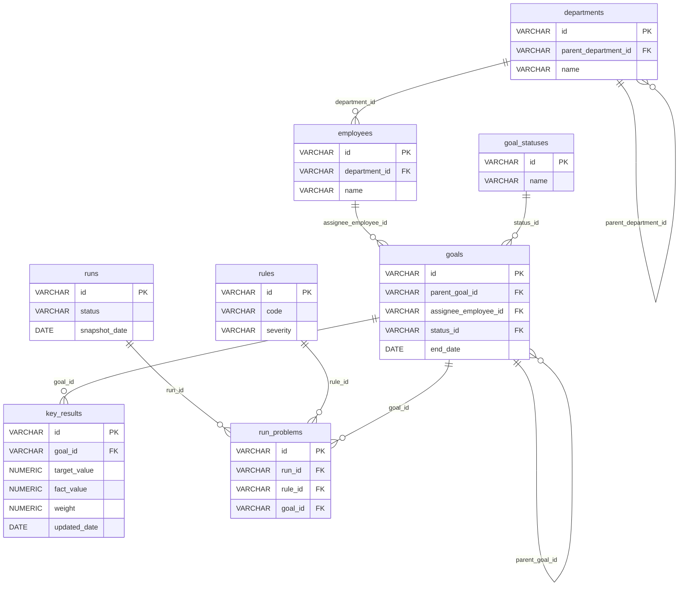

# Design

## Стек

- Java 21
- Spring Boot 3.5.6
- Spring Web
- Spring Data JPA
- PostgreSQL 18
- Liquibase
- Maven
- JUnit 5


## Архитектура

- `api` — контроллеры, DTO, обработчики ошибок
- `application` — сервисы, бизнес-сценарии
- `domain` — сущности, бизнес-правила
- `infrastructure` — репозитории, конфигурация


## Модель данных

### Диаграмма

<details>
<summary>ER-диаграмма</summary>



</details>

### Таблицы

#### departments — подразделения

<details>
<summary>Поля</summary>

| Поле | Тип данных | Ключ | Описание |
|---|---|---|---|
| id | VARCHAR | PK | Идентификатор подразделения |
| parent_department_id | VARCHAR | FK → departments.id | Родительское подразделение (NULL для корневого) |
| name | VARCHAR | | Название подразделения |

</details>


#### employees — сотрудники

<details>
<summary>Поля</summary>

| Поле | Тип данных | Ключ | Описание |
|---|---|---|---|
| id | VARCHAR | PK | Идентификатор сотрудника |
| department_id | VARCHAR | FK → departments.id | Подразделение сотрудника |
| name | VARCHAR | | Имя сотрудника |

</details>


#### goal_statuses — статусы целей

<details>
<summary>Поля</summary>

| Поле | Тип данных | Ключ | Описание |
|---|---|---|---|
| id | VARCHAR | PK | Идентификатор статуса |
| name | VARCHAR | | Название статуса |

</details>


#### goals — цели

<details>
<summary>Поля</summary>

| Поле | Тип данных | Ключ | Описание |
|---|---|---|---|
| id | VARCHAR | PK | Идентификатор цели |
| parent_goal_id | VARCHAR | FK → goals.id | Родительская цель (NULL для верхнеуровневой) |
| assignee_employee_id | VARCHAR | FK → employees.id | Исполнитель цели |
| status_id | VARCHAR | FK → goal_statuses.id | Текущий статус цели |
| end_date | DATE | | Плановая дата завершения цели |

</details>


#### key_results — ключевые результаты

<details>
<summary>Поля</summary>

| Поле | Тип данных | Ключ | Описание |
|---|---|---|---|
| id | VARCHAR | PK | Идентификатор ключевого результата |
| goal_id | VARCHAR | FK → goals.id | Цель, к которой относится KR |
| target_value | NUMERIC | | Целевое значение |
| fact_value | NUMERIC | | Фактическое значение |
| weight | NUMERIC | | Вес KR в рамках цели |
| updated_date | DATE | | Дата последнего обновления факта |

</details>


#### rules — справочник правил

<details>
<summary>Поля</summary>

| Поле | Тип данных | Ключ | Описание |
|---|---|---|---|
| id | VARCHAR | PK | Идентификатор правила |
| code | VARCHAR | | Код правила проверки |
| severity | VARCHAR | | Важность |

</details>


#### runs — прогоны

<details>
<summary>Поля</summary>

| Поле | Тип данных | Ключ | Описание |
|---|---|---|---|
| id | VARCHAR | PK | Идентификатор прогона |
| status | VARCHAR | | Статус прогона |
| snapshot_date | DATE | | Дата, на которую делается срез данных |

</details>


#### run_problems — найденные проблемы

<details>
<summary>Поля</summary>

| Поле | Тип данных | Ключ | Описание |
|---|---|---|---|
| id | VARCHAR | PK | Идентификатор проблемы |
| run_id | VARCHAR | FK → runs.id | Прогон, в котором найдена проблема |
| rule_id | VARCHAR | FK → rules.id | Правило, которое сработало |
| goal_id | VARCHAR | FK → goals.id | Цель, по которой найдена проблема |

</details>


## API

### Проверка состояния сервиса

GET /actuator/health

<details>
<summary>Описание эндпоинта</summary>

Стандартный эндпоинт Spring Boot Actuator. Используется для проверки работоспособности сервиса (в том числе доступности PostgreSQL), например в healthcheck Docker.

#### Входные данные

Нет

Пример запроса:

```
GET /actuator/health
```

#### Выходные данные

Возможные HTTP-коды:

| HTTP-код | Когда возвращается |
|---|---|
| `200 OK` | Сервис работоспособен (`status=UP`) |
| `503 Service Unavailable` | Сервис или БД недоступны (`status=DOWN`) |

Объект состояния сервиса:

| Поле | Тип данных | Обязательность | Описание |
|---|---|---|---|
| status | STRING | Да | Общий статус: `UP` — сервис работоспособен, `DOWN` — нет (HTTP 503) |

Пример ответа (HTTP 200):

```json
{
  "status": "UP"
}
```

Пример ответа (HTTP 503):

```json
{
  "status": "DOWN"
}
```

Детали компонентов (`components`) не раскрываются: `management.endpoint.health.show-details=never` (по умолчанию).

#### Алгоритм

Не требуется

#### Тестирование

Не требуется

</details>


### Получение списка прогонов

GET /api/runs

<details>
<summary>Описание эндпоинта</summary>

#### Входные данные

Нет

Пример запроса:

```
GET /api/runs
```

#### Выходные данные

Возможные HTTP-коды:

| HTTP-код | Когда возвращается |
|---|---|
| `200 OK` | Запрос выполнен успешно (если прогонов нет — пустой массив `[]`) |

Массив объектов прогонов. Каждый элемент массива:

| Поле | Тип данных | Обязательность | Описание |
|---|---|---|---|
| id | STRING | Да | Идентификатор прогона |
| status | STRING | Да | Статус прогона |
| snapshot_date | DATE (`YYYY-MM-DD`) | Да | Дата снимка данных |
| compared_run_id | STRING | Нет | Идентификатор прогона, с которым сравнивается текущий |
| problems_count | INTEGER | Да | Число найденных проблем |

Пример ответа:

```json
[
    {
        "id": "RUN-002",
        "status": "COMPLETED",
        "snapshot_date": "2026-10-26",
        "compared_run_id": "RUN-001",
        "problems_count": 10
    },
    {
        "id": "RUN-001",
        "status": "COMPLETED",
        "snapshot_date": "2026-10-19",
        "compared_run_id": null,
        "problems_count": 10
    }
]
```

#### Алгоритм

1. Получить все прогоны из таблицы `runs`.
2. Для каждого прогона получить количество проблем из таблицы `run_problems` по `runs.id` = `run_problems.run_id`.
3. Отсортировать прогоны по дате снимка (snapshot_date) по убыванию (сначала самый новый); при равной дате - по `id` по убыванию (строковое сравнение).
4. Каждый прогон связать с предыдущим (прогон с ближайшей более ранней датой снимка).
    1. Если для прогона не найден предыдущий прогон, то предыдущий прогон установить null.
5. Вернуть список прогонов:

| Поле в ответе | Источник данных |
|---|---|
| id | runs.id |
| status  | runs.status |
| snapshot_date | runs.snapshot_date |
| compared_run_id | Предыдущий по `snapshot_date` прогон; `null`, если предыдущего нет |
| problems_count | `COUNT(run_problems)` по `run_id`; `0`, если проблем нет |


#### Тестирование

<details>
<summary>Сценарии тестирования</summary>

##### Успешные сценарии

| № | Сценарий | Исходные данные | Ожидаемый результат |
|---|---|---|---|
| 1 | Пример из спецификации | Прогон `RUN-001` (`2026-10-01`, 3 проблемы), прогон `RUN-002` (`2026-11-01`, 5 проблем) | HTTP 200; порядок в массиве: сначала `RUN-002`, затем `RUN-001`; `RUN-002`: `compared_run_id=RUN-001`, `problems_count=5`; `RUN-001`: `compared_run_id=null`, `problems_count=3` |
| 2 | Цепочка из трёх прогонов | Прогоны с датами D1 < D2 < D3 | `compared_run_id`: D1 → `null`, D2 → id(D1), D3 → id(D2) |
| 3 | Подсчёт проблем | Прогон с 4 записями в `run_problems` | `problems_count=4` |
| 4 | Прогон без проблем | Прогон без записей в `run_problems` | `problems_count=0` (не `null`) |
| 5 | Проблемы не смешиваются между прогонами | Прогон A — 2 проблемы, прогон B — 7 проблем | A: `2`, B: `7` |

##### Краевые сценарии

| № | Сценарий | Исходные данные | Ожидаемый результат |
|---|---|---|---|
| 6 | Нет прогонов | Таблица `runs` пуста | HTTP 200, `[]` (не 404, не `null`) |
| 7 | Один прогон | Одна запись в `runs` | Один элемент, `compared_run_id=null` |

</details>

</details>


### Получение метрик по целям и ключевым результатам

GET /api/kkd/summary

<details>
<summary>Описание эндпоинта</summary>

#### Входные данные

| Поле | Тип данных | Обязательность | Описание |
|---|---|---|---|
| run_id | STRING | Да | Идентификатор прогона |
| unit_id | STRING | Да | Идентификатор подразделения |

Пример запроса:

```
GET /api/kkd/summary?run_id=RUN-008&unit_id=HQ-CIB
```

#### Выходные данные

Возможные HTTP-коды:

| HTTP-код | Когда возвращается |
|---|---|
| `200 OK` | Запрос выполнен успешно |
| `404 Not Found` | Прогон с `run_id` не найден или подразделение с `unit_id` не найдено (алгоритм, шаги 1.1 и 3.1) |
| `422 Unprocessable Entity` | Не указан `run_id` или `unit_id` |

Тело ошибки — в едином формате, см. «Обработка ошибок».

Объект со сводкой метрик. Поля верхнего уровня:

| Поле | Тип данных | Обязательность | Описание |
|---|---|---|---|
| run | OBJECT | Да | Текущий прогон |
| run.id | STRING | Да | Идентификатор прогона |
| run.snapshot_date | DATE (`YYYY-MM-DD`) | Да | Дата снимка данных |
| compared_to | OBJECT | Нет | Прогон, с которым сравнивается текущий; `null`, если предыдущего прогона нет |
| compared_to.id | STRING | Да | Идентификатор прогона сравнения |
| compared_to.snapshot_date | DATE (`YYYY-MM-DD`) | Да | Дата снимка данных прогона сравнения |
| unit | OBJECT | Да | Подразделение, по которому построена сводка |
| unit.id | STRING | Да | Идентификатор подразделения |
| unit.name | STRING | Да | Название подразделения |
| metrics | ARRAY | Да | Метрики качества данных по целям и ключевым результатам |
| issues_by_severity | ARRAY | Да | Количество проблем в разрезе критичности |
| delta | OBJECT | Да | Изменение набора проблем относительно прогона сравнения |

<details>
<summary>Элемент `metrics`</summary>

| Поле | Тип данных | Обязательность | Описание |
|---|---|---|---|
| key | STRING | Да | Машинный ключ метрики (например, `clean_goals_share`) |
| title | STRING | Да | Название метрики для отображения |
| unit | STRING | Да | Единица измерения значения (например, `%`) |
| value | NUMERIC | Да | Значение метрики в текущем прогоне |
| previous | NUMERIC | Нет | Значение метрики в прогоне сравнения; `null`, если прогона сравнения нет |
| delta | NUMERIC | Нет | Изменение: `value - previous`; `null`, если прогона сравнения нет |
| trend | STRING | Да | Направление изменения: `better` — улучшение, `worse` — ухудшение, `same` — без изменений |

</details>

<details>
<summary>Элемент `issues_by_severity`</summary>

| Поле | Тип данных | Обязательность | Описание |
|---|---|---|---|
| code | STRING | Да | Код критичности (например, `critical`, `major`) |
| current | INTEGER | Да | Количество проблем в текущем прогоне |
| previous | INTEGER | Нет | Количество проблем в прогоне сравнения; `null`, если прогона сравнения нет |
| delta | INTEGER | Нет | Изменение: `current - previous`; `null`, если прогона сравнения нет |

</details>

<details>
<summary>Объект `delta`</summary>

| Поле | Тип данных | Обязательность | Описание |
|---|---|---|---|
| new | INTEGER | Да | Количество новых проблем (есть в текущем прогоне, нет в прогоне сравнения) |
| persisting | INTEGER | Да | Количество сохранившихся проблем (есть в обоих прогонах) |
| resolved | INTEGER | Да | Количество устранённых проблем (были в прогоне сравнения, нет в текущем) |

</details>

Пример ответа:

```json
{
  "run": { "id": "RUN-008", "snapshot_date": "2026-10-26" },
  "compared_to": { "id": "RUN-007", "snapshot_date": "2026-10-19" },
  "unit": { "id": "HQ-CIB", "name": "Департамент корпоративного бизнеса" },
  "metrics": [
    {
      "key": "clean_goals_share",
      "title": "Доля корректных целей",
      "unit": "%",
      "value": 56.5,
      "previous": 62.7,
      "delta": -6.2,
      "trend": "worse"
    }
  ],
  "issues_by_severity": [
    { "code": "critical", "current": 2, "previous": 2, "delta": 0 },
    { "code": "major", "current": 23, "previous": 15, "delta": 8 }
  ],
  "delta": { "new": 10, "persisting": 33, "resolved": 2 }
}
```

#### Алгоритм

1. Получить прогон из таблицы `runs` по условию: runs.id = run_id.
    1. Если прогон не найден, то вернуть 404 с ошибкой "Прогон с ID {run_id} не найден".
2. Получить предыдущий прогон: отсортировать таблицу `runs` по snapshot_date по убыванию, отфильтровать по условию: snapshot_date < snapshot_date из полученного прогона на предыдущем шаге, и взять первую полученную запись.
3. Получить подразделение сотрудников из таблицы `departments` по условию: departments.id = unit_id.
    1. Если подразделение не найдено, то вернуть 404 с ошибкой "Подразделение с ID {unit_id} не найдено".
4. Определить набор подразделений для расчёта: подразделение из шага 3 и все его вложенные подразделения (рекурсивно по `departments.parent_department_id`).
5. Получить цели подразделения: записи `goals`, у которых `goals.assignee_employee_id` = `employees.id` и `employees.department_id` входит в набор подразделений из шага 4. Если целей нет, расчёт продолжается (см. п. 7.1).
6. Получить проблемы для расчёта: записи `run_problems` с присоединённым правилом (`run_problems.rule_id` = `rules.id`), у которых `run_problems.goal_id` входит в цели из шага 5. Выбрать отдельно:
    1. проблемы текущего прогона (`run_problems.run_id` = `run_id`);
    2. проблемы предыдущего прогона (`run_problems.run_id` = id прогона из шага 2) — только если предыдущий прогон найден.
7. Рассчитать метрики (все три, в указанном порядке) отдельно для текущего и предыдущего прогонов. Метрики считаются по целям и проблемам всего подразделения с учётом дочерних (шаги 4–6). Значения округляются до 1 знака (`HALF_UP`):

    | key | title | unit | Формула `value` | Что считается улучшением |
    |---|---|---|---|---|
    | `clean_goals_share` | Доля корректных целей | `%` | (число целей без проблем / общее число целей) × 100. Цель корректна, если на её `goals.id` нет ни одной записи в `run_problems` данного прогона | Рост |
    | `issues_per_goal` | Проблем на одну цель | `шт.` | общее число проблем / общее число целей | Снижение |
    | `critical_goals_share` | Доля целей с критичными проблемами | `%` | (число целей, у которых есть хотя бы одна проблема с `rules.severity` = `critical` / общее число целей) × 100 | Снижение |

    Если целей в подразделении нет, `value` всех метрик = 0.
    1. `previous` = значение, рассчитанное по предыдущему прогону; `null`, если предыдущего прогона нет.
    2. `delta` = `value` - `previous`, округлить до 1 знака; `null`, если предыдущего прогона нет.
    3. `trend`: если `delta` = 0 или `null`, то `same`. Иначе для метрик, где улучшение — рост (`clean_goals_share`): `better` при `delta` > 0, `worse` при `delta` < 0; для метрик, где улучшение — снижение (`issues_per_goal`, `critical_goals_share`): наоборот.
8. Сформировать `issues_by_severity`: сгруппировать проблемы шага 6 по `rules.severity` отдельно для текущего и предыдущего прогонов.
    1. В результат входят все значения `severity`, встретившиеся хотя бы в одном из двух прогонов; если в одном из прогонов проблем с такой критичностью нет, то количество = 0.
    2. `code` = `rules.severity`; `current` = количество проблем текущего прогона; `previous` = количество проблем предыдущего прогона (`null`, если предыдущего прогона нет); `delta` = `current` - `previous` (`null`, если предыдущего прогона нет).
    3. Порядок элементов: по убыванию критичности (`critical`, `major`, далее остальные значения по алфавиту).
9. Рассчитать `delta` (изменение набора проблем). Проблема идентифицируется парой (`rule_id`, `goal_id`):
    1. `new` — количество пар, которые есть в текущем прогоне и отсутствуют в предыдущем;
    2. `persisting` — количество пар, которые есть в обоих прогонах;
    3. `resolved` — количество пар, которые есть в предыдущем прогоне и отсутствуют в текущем;
    4. если предыдущего прогона нет: `new` = число проблем текущего прогона, `persisting` = 0, `resolved` = 0.
10. Вернуть ответ `200 OK`:

| Поле в ответе | Источник данных |
|---|---|
| run.id, run.snapshot_date | `runs.id`, `runs.snapshot_date` прогона из шага 1 |
| compared_to.id, compared_to.snapshot_date | `runs.id`, `runs.snapshot_date` прогона из шага 2; `compared_to` = `null`, если предыдущего прогона нет |
| unit.id, unit.name | `departments.id`, `departments.name` подразделения из шага 3 |
| metrics | Результат шага 7 (три метрики) |
| issues_by_severity | Результат шага 8 |
| delta | Результат шага 9 |

#### Тестирование

<details>
<summary>Сценарии тестирования</summary>

##### Базовые тестовые данные

Если в сценарии не сказано иное, используются данные Ф1:

- подразделение `U` (запрос с `unit_id=U`) без дочерних, в нём 4 цели `G1`–`G4` (исполнитель — сотрудник `U`);
- правила: `R-CRIT` (`severity=critical`), `R-MAJ` и `R-MAJ2` (`severity=major`);
- прогоны `RUN-001` (`2026-10-19`) и `RUN-002` (`2026-10-26`); запрос с `run_id=RUN-002`, предыдущий прогон — `RUN-001`.

Проблема в сценариях записывается как (правило, цель).

##### Успешные сценарии

| № | Сценарий | Исходные данные | Ожидаемый результат |
|---|---|---|---|
| 1 | Улучшение: иерархия подразделений, выбор предыдущего прогона, фильтрация | Подразделение `U` с дочерним `C`; цели `G1`, `G2` — в `U`, `G3`, `G4` — в `C`; соседнее подразделение `S` (не дочернее) с целью `G5`. Прогоны: `RUN-000` (`2026-10-12`), `RUN-005` (`2026-10-19`), `RUN-002` (`2026-10-26`), `RUN-003` (`2026-11-02`) с любыми проблемами на `G1`–`G4` у `RUN-000` и `RUN-003`. Проблемы `RUN-002`: (`R-CRIT`,`G1`), (`R-MAJ`,`G3`), (`R-CRIT`,`G5`). Проблемы `RUN-005`: (`R-CRIT`,`G1`), (`R-CRIT`,`G2`), (`R-MAJ`,`G3`), (`R-CRIT`,`G5`). Запрос: `run_id=RUN-002`, `unit_id=U` | HTTP 200. `compared_to.id=RUN-005` (ближайший по дате, а не по `id`; `RUN-000` и `RUN-003` не учитываются). Цель `G5` и её проблемы не учитываются (другое подразделение), `G3`, `G4` из дочернего `C` учитываются. `metrics` — три элемента в порядке `clean_goals_share`, `issues_per_goal`, `critical_goals_share`: `50.0` / `25.0` / `25.0` / `better`; `0.5` / `0.8` / `-0.3` / `better`; `25.0` / `50.0` / `-25.0` / `better` (`value` / `previous` / `delta` / `trend`). `issues_by_severity`: `critical` 1/2/-1, `major` 1/1/0. `delta`: `new=0`, `persisting=2`, `resolved=1`. Тот же запрос с `unit_id=C`: 2 цели, метрики `50.0` / `0.5` / `0.0`, `trend=same`, `delta`: `new=0`, `persisting=1`, `resolved=0` |
| 2 | Ухудшение и разнонаправленные тренды | Ф1. `RUN-002`: (`R-CRIT`,`G1`), (`R-MAJ`,`G1`), (`R-MAJ2`,`G1`). `RUN-001`: (`R-MAJ`,`G1`), (`R-MAJ`,`G2`) | `clean_goals_share`: `75.0`, `50.0`, `25.0`, `better` (несколько проблем на одной цели считаются как одна цель). `issues_per_goal`: `0.8`, `0.5`, `0.3`, `worse`. `critical_goals_share`: `25.0`, `0.0`, `25.0`, `worse`. `issues_by_severity`: `critical` 1/0/1, `major` 2/2/0. `delta`: `new=2` ((`R-CRIT`,`G1`), (`R-MAJ2`,`G1`)), `persisting=1`, `resolved=1` |
| 3 | Нет предыдущего прогона и округление `HALF_UP` | Ф1, существует только `RUN-002` с одной проблемой (`R-CRIT`,`G1`) | `compared_to=null`; `clean_goals_share=75.0`, `issues_per_goal=0.3` (0.25 округляется вверх, не до 0.2), `critical_goals_share=25.0`; у всех метрик `previous=null`, `delta=null`, `trend=same`; `issues_by_severity`: `critical` `current=1`, `previous=null`, `delta=null`; `delta`: `new=1`, `persisting=0`, `resolved=0` |

##### Краевые сценарии

| № | Сценарий | Исходные данные | Ожидаемый результат |
|---|---|---|---|
| 4 | В подразделении нет целей | `U` без целей (или без сотрудников), есть предыдущий прогон | HTTP 200 (не 404, не деление на ноль); `value` и `previous` всех метрик `0.0`, `delta=0.0`, `trend=same`; `issues_by_severity=[]`; `delta`: `new=0`, `persisting=0`, `resolved=0` |
| 5 | Нет проблем в текущем и предыдущем прогонах | Ф1 без записей в `run_problems` | `clean_goals_share=100.0`, `issues_per_goal=0.0`, `critical_goals_share=0.0`; `issues_by_severity=[]`; `delta` — все нули |
| 6 | Все цели с проблемами | Ф1, на каждой из `G1`–`G4` по проблеме | `clean_goals_share=0.0` |
| 7 | Несколько проблем на одной цели | Ф1, на `G1` три проблемы (`R-CRIT`, `R-MAJ`, `R-MAJ2`) | `clean_goals_share=75.0` (считаются цели), `issues_per_goal=0.8` (считаются проблемы, 3/4=0.75), `critical_goals_share=25.0` |
| 8 | Несколько критичных проблем на одной цели | Ф1, на `G1` две проблемы с `severity=critical` (разные правила) | `critical_goals_share=25.0` (цель считается один раз), `issues_by_severity`: `critical` `current=2` |
| 9 | Пара (правило, цель) определяет проблему | `RUN-001`: (`R-MAJ`,`G1`); `RUN-002`: (`R-MAJ`,`G2`) | `delta`: `new=1`, `persisting=0`, `resolved=1` (то же правило на другой цели — другая проблема) |
| 10 | То же правило на той же цели в обоих прогонах | `RUN-001` и `RUN-002`: (`R-MAJ`,`G1`) | `delta`: `new=0`, `persisting=1`, `resolved=0` |
| 11 | Текущий прогон без проблем, в предыдущем они есть | `RUN-002` без проблем, `RUN-001`: 2 проблемы | `clean_goals_share`: `100.0` vs `50.0`, `better`; `delta`: `new=0`, `persisting=0`, `resolved=2` |
| 12 | В предыдущем прогоне проблем нет, в текущем есть | `RUN-001` без проблем, `RUN-002`: 2 проблемы | `delta`: `new=2`, `persisting=0`, `resolved=0`; `issues_by_severity`: `previous=0` |
| 13 | Прогоны с одинаковой `snapshot_date` | `RUN-001` и `RUN-002` с одной датой; запрос по `RUN-002` | Прогон с той же датой не считается предыдущим (сравнение `snapshot_date <` строгое): `compared_to=null`, если более ранних прогонов нет |
| 14 | Самый ранний прогон | Запрос по прогону с наименьшей датой при наличии более поздних | `compared_to=null`, `previous=null` у всех метрик |
| 15 | Подразделение без дочерних | Листовое подразделение `U` | Рассчитывается только по собственным целям |
| 16 | Вложенные цели (`parent_goal_id`) | `G2` — дочерняя цель `G1`, обе исполнители из `U`, проблема только на `G1` | Обе цели считаются отдельно: общее число целей учитывает и `G1`, и `G2`; проблема `G1` на `G2` не переносится |

##### Негативные сценарии

| № | Сценарий | Исходные данные | Ожидаемый результат |
|---|---|---|---|
| 17 | Прогон не найден | `GET /api/kkd/summary?run_id=RUN-999&unit_id=U` | HTTP 404; `error.code=NOT_FOUND`; `error.message="Прогон с ID RUN-999 не найден"` |
| 18 | Подразделение не найдено | `GET /api/kkd/summary?run_id=RUN-002&unit_id=UNKNOWN` | HTTP 404; `error.code=NOT_FOUND`; `error.message="Подразделение с ID UNKNOWN не найдено"` |
| 19 | Не найдены ни прогон, ни подразделение | Несуществующие `run_id` и `unit_id` | HTTP 404; сообщение о прогоне (прогон проверяется первым, шаг 1.1) |
| 20 | Не указан `run_id` | `GET /api/kkd/summary?unit_id=U` | HTTP 422; `error.code=VALIDATION_ERROR`; запросов к БД нет |
| 21 | Не указан `unit_id` | `GET /api/kkd/summary?run_id=RUN-002` | HTTP 422; `error.code=VALIDATION_ERROR` |
| 22 | Не указаны оба параметра | `GET /api/kkd/summary` | HTTP 422; `error.code=VALIDATION_ERROR` |
| 23 | Ошибка БД | Репозиторий выбрасывает исключение | HTTP 500; `error.code=INTERNAL_ERROR`; в `error.message` нет стектрейса и SQL |

</details>

</details>


### Получение списка проблем прогона

GET /api/kkd/issues

<details>
<summary>Описание эндпоинта</summary>

Возвращает проблемы одного прогона с необязательными фильтрами по подразделению (с учётом дочерних), правилу и важности и постраничной выдачей.

#### Входные данные

| Поле | Тип данных | Обязательность | Описание |
|---|---|---|---|
| run_id | STRING | Да | Идентификатор прогона |
| unit_id | STRING | Нет | Идентификатор подразделения; проблемы выбираются по целям подразделения и всех его вложенных подразделений |
| rule_code | STRING | Нет | Код правила (`rules.code`), например `GOAL_NO_OWNER` |
| severity | STRING | Нет | Важность (`rules.severity`): `critical`, `major` или `minor` |
| limit | INTEGER | Нет | Размер страницы, от 1 до 100. По умолчанию `20` |
| offset | INTEGER | Нет | Сколько записей пропустить, не меньше 0. По умолчанию `0` |

Фильтры комбинируются через логическое «И». Не переданный фильтр не применяется.

Пример запроса:

```
GET /api/kkd/issues?run_id=RUN-002&unit_id=HQ-CIB&severity=critical&limit=10&offset=0
```

#### Выходные данные

Возможные HTTP-коды:

| HTTP-код | Когда возвращается |
|---|---|
| `200 OK` | Запрос выполнен успешно (если проблем по фильтрам нет — `items=[]`, `total=0`) |
| `404 Not Found` | Прогон с `run_id`, подразделение с `unit_id` или правило с `rule_code` не найдены (алгоритм, шаги 2.1, 3.1 и 4.1) |
| `422 Unprocessable Entity` | Не указан `run_id`; `limit` или `offset` не целое число или вне допустимого диапазона; `severity` не из списка допустимых значений |

Тело ошибки — в едином формате, см. «Обработка ошибок».

Объект страницы:

| Поле | Тип данных | Обязательность | Описание |
|---|---|---|---|
| items | ARRAY | Да | Проблемы текущей страницы |
| total | INTEGER | Да | Общее число проблем, подходящих под фильтры (без учёта `limit` и `offset`) |
| limit | INTEGER | Да | Применённый размер страницы |
| offset | INTEGER | Да | Применённое смещение |

<details>
<summary>Элемент `items`</summary>

| Поле | Тип данных | Обязательность | Описание |
|---|---|---|---|
| id | STRING | Да | Идентификатор проблемы (`run_problems.id`) |
| rule_code | STRING | Да | Код сработавшего правила |
| severity | STRING | Да | Важность правила |
| goal_id | STRING | Да | Идентификатор цели, по которой найдена проблема |
| unit | OBJECT | Нет | Подразделение исполнителя цели; `null`, если у цели нет исполнителя (например, `GOAL_NO_OWNER`) |
| unit.id | STRING | Да | Идентификатор подразделения |
| unit.name | STRING | Да | Название подразделения |

</details>

Пример ответа:

```json
{
  "items": [
    {
      "id": "PRB-002",
      "rule_code": "GOAL_NO_OWNER",
      "severity": "critical",
      "goal_id": "G-05",
      "unit": null
    },
    {
      "id": "PRB-001",
      "rule_code": "GOAL_NO_KR",
      "severity": "critical",
      "goal_id": "G-01",
      "unit": { "id": "CIB-SALES", "name": "Отдел продаж КИБ" }
    }
  ],
  "total": 7,
  "limit": 2,
  "offset": 0
}
```

#### Алгоритм

1. Проверить параметры запроса; при нарушении вернуть 422 с ошибкой `VALIDATION_ERROR`:
    1. `run_id` указан и не пустой;
    2. `limit` — целое число от 1 до 100, если не указан — `20`;
    3. `offset` — целое число не меньше 0, если не указан — `0`;
    4. `severity`, если указан, — одно из `critical`, `major`, `minor`.
2. Получить прогон из таблицы `runs` по условию: runs.id = run_id.
    1. Если прогон не найден, то вернуть 404 с ошибкой "Прогон с ID {run_id} не найден".
3. Если указан `unit_id`, получить подразделение из таблицы `departments` по условию: departments.id = unit_id.
    1. Если подразделение не найдено, то вернуть 404 с ошибкой "Подразделение с ID {unit_id} не найдено".
    2. Определить набор подразделений: подразделение и все его вложенные подразделения (рекурсивно по `departments.parent_department_id`).
4. Если указан `rule_code`, получить правило из таблицы `rules` по условию: rules.code = rule_code.
    1. Если правило не найдено, то вернуть 404 с ошибкой "Правило с кодом {rule_code} не найдено".
5. Выбрать проблемы: записи `run_problems` с `run_problems.run_id` = run_id, присоединив правило (`run_problems.rule_id` = `rules.id`), цель (`run_problems.goal_id` = `goals.id`) и через `LEFT JOIN` исполнителя цели (`goals.assignee_employee_id` = `employees.id`) с его подразделением (`employees.department_id` = `departments.id`). Применить переданные фильтры:
    1. `unit_id` — `employees.department_id` входит в набор подразделений из шага 3.2 (проблемы целей без исполнителя в выборку не попадают);
    2. `rule_code` — `rules.code` = rule_code;
    3. `severity` — `rules.severity` = severity.
6. Посчитать `total` — количество записей, подходящих под фильтры шага 5, до применения `limit` и `offset`.
7. Отсортировать выбранные проблемы: по важности (`critical`, `major`, `minor`), затем по `run_problems.id` по возрастанию (строковое сравнение). Порядок детерминирован, поэтому страницы не пересекаются и не теряют записи.
8. Применить пагинацию: пропустить `offset` записей и взять не более `limit`. Если `offset` ≥ `total`, `items` пустой, а `total` остаётся прежним.
9. Вернуть ответ `200 OK`:

| Поле в ответе | Источник данных |
|---|---|
| items[].id | `run_problems.id` |
| items[].rule_code | `rules.code` |
| items[].severity | `rules.severity` |
| items[].goal_id | `run_problems.goal_id` |
| items[].unit | `departments.id`, `departments.name` исполнителя цели; `null`, если исполнителя нет |
| total | Результат шага 6 |
| limit, offset | Применённые значения из шага 1 |

#### Тестирование

<details>
<summary>Сценарии тестирования</summary>

##### Базовые тестовые данные

Если в сценарии не сказано иное, используются данные Ф2:

- подразделение `U` с дочерним `C` и отдельное подразделение `S` (не дочернее); в каждом по одному сотруднику;
- цели: `G1`, `G2` — исполнитель из `U`; `G3` — из `C`; `G4` — из `S`;
- правила: `R-CRIT` (`severity=critical`), `R-MAJ` и `R-MAJ2` (`severity=major`), `R-MIN` (`severity=minor`);
- прогоны `RUN-001` (`2026-10-19`) и `RUN-002` (`2026-10-26`);
- проблемы `RUN-002` (правило, цель): `P1` (`R-CRIT`,`G1`), `P2` (`R-MAJ`,`G1`), `P3` (`R-MAJ`,`G3`), `P4` (`R-MIN`,`G2`), `P5` (`R-CRIT`,`G4`);
- проблема `RUN-001`: `P6` (`R-CRIT`,`G1`).

Запрос выполняется с `run_id=RUN-002`. Порядок без фильтров: `P1`, `P5`, `P2`, `P3`, `P4`.

##### Успешные сценарии

| № | Сценарий | Исходные данные | Ожидаемый результат |
|---|---|---|---|
| 1 | Без фильтров: сортировка и изоляция прогона | Ф2, `run_id=RUN-002` | HTTP 200; `items`: `P1`, `P5`, `P2`, `P3`, `P4` (по важности, затем по `id`); `total=5`, `limit=20`, `offset=0`; `P6` из `RUN-001` в выдаче нет |
| 2 | Поля элемента | Ф2, проблема `P3` | `rule_code=R-MAJ`, `severity=major`, `goal_id=G3`, `unit.id=C`, `unit.name` — название `C` |
| 3 | Фильтр по подразделению с дочерними | Ф2, `unit_id=U` | `items`: `P1`, `P2`, `P3`, `P4`; `total=4` (`P3` из дочернего `C` учтён, `P5` из `S` — нет) |
| 4 | Фильтр по дочернему подразделению | Ф2, `unit_id=C` | `items`: `P3`; `total=1` (родительское подразделение не захватывается) |
| 5 | Фильтр по правилу | Ф2, `rule_code=R-MAJ` | `items`: `P2`, `P3`; `total=2` |
| 6 | Фильтр по важности | Ф2, `severity=major` | `items`: `P2`, `P3` (правила `R-MAJ` и `R-MAJ2` вместе); `total=2` |
| 7 | Комбинация фильтров | Ф2, `unit_id=U`, `severity=critical` | `items`: `P1`; `total=1` |
| 8 | Пагинация: первая страница | Ф2, `limit=2`, `offset=0` | `items`: `P1`, `P5`; `total=5`, `limit=2`, `offset=0` |
| 9 | Пагинация: следующие страницы | Ф2, `limit=2`, `offset=2` и `offset=4` | `offset=2`: `P2`, `P3`; `offset=4`: `P4`; `total=5` на обеих; страницы не пересекаются |

##### Краевые сценарии

| № | Сценарий | Исходные данные | Ожидаемый результат |
|---|---|---|---|
| 10 | Значения `limit` и `offset` по умолчанию | Ф2, без `limit` и `offset` | `limit=20`, `offset=0` в ответе |
| 11 | Граничные значения `limit` | `limit=1` и `limit=100` | HTTP 200; при `limit=1` один элемент, при `limit=100` — все 5 |
| 12 | `offset` за пределами выборки | Ф2, `offset=5` и `offset=100` | HTTP 200; `items=[]`, `total=5` |
| 13 | В прогоне нет проблем | Прогон без записей в `run_problems` | HTTP 200; `items=[]`, `total=0` (не 404) |
| 14 | Фильтры не дают результата | Ф2, `unit_id=C`, `severity=critical` | HTTP 200; `items=[]`, `total=0` |
| 15 | Цель без исполнителя | Цель `G5` без `assignee_employee_id`, проблема (`R-CRIT`,`G5`) в `RUN-002` | Без фильтра по подразделению проблема есть в выдаче, `unit=null`; с `unit_id=U` — отсутствует |
| 16 | Подразделение без проблем | Ф2, подразделение без целей | HTTP 200; `items=[]`, `total=0` |
| 17 | Несколько проблем на одной цели | Ф2: на `G1` две проблемы (`P1`, `P2`) | Обе возвращаются отдельными элементами |

##### Негативные сценарии

| № | Сценарий | Исходные данные | Ожидаемый результат |
|---|---|---|---|
| 18 | Прогон не найден | `run_id=RUN-999` | HTTP 404; `error.code=NOT_FOUND`; `error.message="Прогон с ID RUN-999 не найден"` |
| 19 | Подразделение не найдено | `run_id=RUN-002&unit_id=UNKNOWN` | HTTP 404; `error.code=NOT_FOUND`; `error.message="Подразделение с ID UNKNOWN не найдено"` |
| 20 | Правило не найдено | `run_id=RUN-002&rule_code=UNKNOWN` | HTTP 404; `error.code=NOT_FOUND`; `error.message="Правило с кодом UNKNOWN не найдено"` |
| 21 | Не найдены прогон и подразделение | Несуществующие `run_id` и `unit_id` | HTTP 404; сообщение о прогоне (прогон проверяется первым, шаг 2.1) |
| 22 | Не указан `run_id` | `GET /api/kkd/issues` | HTTP 422; `error.code=VALIDATION_ERROR`; запросов к БД нет |
| 23 | Недопустимый `limit` | `limit=0`, `limit=101`, `limit=abc` | HTTP 422; `error.code=VALIDATION_ERROR` |
| 24 | Недопустимый `offset` | `offset=-1`, `offset=abc` | HTTP 422; `error.code=VALIDATION_ERROR` |
| 25 | Недопустимая `severity` | `severity=blocker` | HTTP 422; `error.code=VALIDATION_ERROR` |
| 26 | Ошибка БД | Репозиторий выбрасывает исключение | HTTP 500; `error.code=INTERNAL_ERROR`; в `error.message` нет стектрейса и SQL |

</details>

</details>


## Ключевые решения

### Тестирование

1. Уровни: сервис (unit, репозиторий замокан); контроллер (`@WebMvcTest` + `MockMvc`) — формат ответа и коды; интеграционный (PostgreSQL + Liquibase) — реальный запрос и подсчёт `run_problems`.
2. HTTP-сервер в тестах не запускается: никаких `@SpringBootTest(webEnvironment = RANDOM_PORT/DEFINED_PORT)` и `TestRestTemplate`. Запросы выполняются через `MockMvc` (без сетевого порта); интеграционные тесты проверяют сервис и репозиторий напрямую (`@DataJpaTest` или `@SpringBootTest(webEnvironment = MOCK)`), без HTTP.
3. Не нужно делать тесты на "Формат ответа", "Формат тела ошибки".
4. Не нужно проверять большие объёмы, это не нагрузочное тестирование.
5. Тест на 405 не нужен.


## Обработка ошибок

Все ошибки возвращаются в едином формате, заданном в тестовом задании (`Content-Type: application/json`): объект с единственным полем `error`, внутри которого `code` и `message`.

| Поле | Тип данных | Обязательность | Описание |
|---|---|---|---|
| error | OBJECT | Да | Описание ошибки |
| error.code | STRING | Да | Машинный код ошибки |
| error.message | STRING | Да | Описание ошибки без внутренних деталей (стектрейс, SQL) |

Пример:

```json
{
  "error": {
    "code": "NOT_FOUND",
    "message": "Прогон с ID RUN-999 не найден"
  }
}
```

Коды ошибок:

| HTTP-код | error.code | Когда возникает |
|---|---|---|
| 404 | `NOT_FOUND` | Ресурс не найден (в том числе прогон или подразделение с указанным ID) |
| 422 | `VALIDATION_ERROR` | Ошибка валидации входных данных: не указан обязательный параметр запроса или его значение неверного типа |
| 500 | `INTERNAL_ERROR` | Любая непредвиденная ошибка, в том числе ошибка БД; детали пишутся только в лог |
